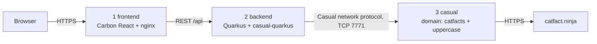

# Spec: casual-bob, a catfacts web app on OpenShift

Status: implemented for the `dev` environment. All three components and the `deploy/` manifests
exist in this repo. Each component spec carries its own status line. Not yet done: the local
`compose.yaml` run (section 7) and a `prod` overlay (section 5). The `catfacts` Casual service is
built from scratch in this repo, from the requirements in section 4.

**This is an overview document.** It describes the whole system, the contracts between the three
components, the repository layout and the deployment. Each component has its own, more detailed
spec (see section 9). Where this document and a
component spec disagree about a component's internals, the component spec wins. Where they disagree
about an interface between components (section 3), they must be reconciled before building.

## 1. Goal

A web page with a button. Pressing it shows a random cat fact (upper-cased), fetched through three
containers. The goal is to prove the full path from browser to Casual on OpenShift, deployed through
OpenShift GitOps and built in-cluster with BuildConfigs.



## 2. Containers

| # | Name | Contents | Port |
|---|---|---|---|
| 1 | `frontend` | Carbon React app built to static files, served by nginx. nginx also proxies `/api/` to `backend`, so the browser sees one origin and no CORS is needed. | 8080 |
| 2 | `backend` | Quarkus (Java 25) with the `casual-quarkus` extension, outbound only | 8080 |
| 3 | `casual` | Casual runtime image plus the `catfacts` server built in this repo and the domain definition. The domain has the `catfacts` server, the `casual/example/uppercase` service that ships with Casual, and a gateway listener. | 7771 |

## 3. Interfaces

| Between | Interface |
|---|---|
| Browser → frontend | `GET /` (page) |
| Frontend → backend | `GET /api/fact` → `200 {"fact":"<text>"}`; on failure `502` (service error or unreachable) or `504` (timeout) with `{"error":"<message>"}` |
| Backend → casual | `tpcall` of `catfacts/random` with a small X_OCTET buffer. The reply buffer holds the fact text. Connection host `casual`, port `7771`. |
| Casual → internet | `GET https://catfact.ninja/fact` → `{"fact":"<text>","length":<n>}` |

## 4. Behaviour

A summary of what each component does. The component specs (section 9) hold the full requirements.

### 4.1 Casual service `catfacts/random`

- One server with one instance, advertising one service named `catfacts/random`.
- The request buffer is ignored.
- On each call it fetches a fact from `https://catfact.ninja/fact`, takes only the `fact` field and
  ignores any other fields.
- It returns the fact text upper-cased in an X_OCTET buffer. The upper-casing is done by forwarding
  the reply to the `casual/example/uppercase` service in the same domain.
- It fails the call (`TPFAIL`, no reply data) when the fact cannot be produced: no network, timeout,
  HTTP status other than 200, a body that is not valid JSON, or a missing or empty `fact`.
- The HTTP call has a connect timeout and a total timeout, both configurable by server arguments,
  with a total default of 5 seconds. It follows no redirects and limits the response size.
- It is written in C++ against the public XATMI API, uses libcurl for HTTP, and is built with
  `casual-build-server`. It uses no Casual headers other than those installed with the Casual runtime
  (no internal `common/*` headers).
- The JSON body is parsed with [nlohmann/json](https://github.com/nlohmann/json) (MIT licence), the
  single-header `json.hpp`. It is vendored in `casual/third_party/nlohmann/` together with its licence
  text, so the build needs no network access and no Casual source tree.
- Parsing the response body is kept separate from the HTTP and XATMI code, in a header-only function
  that has no Casual dependency, so it can be unit tested without a network or a running domain. The
  unit test covers at least a valid body (with an extra field) and a body that is not JSON.

### 4.2 Backend

One REST endpoint, and the Quarkus health endpoints `/q/health/live` and `/q/health/ready` for the
liveness and readiness probes. It maps Casual call errors to the status codes in section 3.

### 4.3 Frontend

One page with a Carbon `Button` ("Get a cat fact") and a `Tile` for the result. It shows a loading
state and an `InlineNotification` on error. It makes no direct calls to Casual or catfact.ninja.

### 4.4 Casual domain

`domain.yaml` defines the servers and a gateway listener on `0.0.0.0:7771`. State is under
`emptyDir`, since the service uses no queues or transactions.

## 5. Repository: `casual-bob` (public GitHub)

```
casual-bob/
├── SPEC.md                # this overview
├── AGENTS.md              # how to work in this repo (gh usage, Casual OpenWiki)
├── frontend/              # SPEC.md, Carbon React app (Vite, TypeScript), Containerfile,
│                          #   nginx.conf.template, start.sh (renders the nginx config at startup)
├── backend/               # SPEC.md, README.md, AGENTS.md, Quarkus project (Gradle), Containerfile
├── casual/                # SPEC.md, src/ (catfacts.cpp, catfacts.fact.h), test/, services.yaml,
│   │                      #   domain.yaml, Containerfile (two stages: build server, then runtime),
│   │                      #   build-test.sh (unit test), shell.sh (boot the domain and call the service)
│   └── third_party/nlohmann/   # vendored json.hpp + LICENSE.MIT
└── deploy/                # everything Argo CD reads
    ├── argocd/
    │   └── casual-bob-app.yaml      # Argo CD Application (in namespace openshift-gitops)
    ├── base/
    │   ├── kustomization.yaml
    │   ├── frontend/    (kustomization.yaml, deployment.yaml, service.yaml, route.yaml, configmap.yaml,
    │   │                 imagestream.yaml, buildconfig.yaml)
    │   ├── backend/     (kustomization.yaml, deployment.yaml, service.yaml, configmap.yaml,
    │   │                 imagestream.yaml, buildconfig.yaml)
    │   └── casual/      (kustomization.yaml, deployment.yaml, service.yaml, imagestream.yaml,
    │                     buildconfig.yaml)
    └── overlays/
        └── dev/         (kustomization.yaml: namespace casual)
```

Not yet in the repository, and still wanted:

- a root `README.md`
- `compose.yaml` (section 7)
- `deploy/overlays/prod/`

- This is the usual Argo CD reference layout: a Kustomize `base` for the resources, `overlays/<env>`
  for per-environment differences, and one `argocd/` folder for the Application resource.
- The repo is public, so it contains no secrets, tokens or cluster-specific hostnames. The Route host
  is left for OpenShift to generate. Nothing in the app needs a secret.

## 6. Build and deployment (OpenShift GitOps)

- **Build:** each container has an `ImageStream` and a `BuildConfig` (Docker strategy). The source is
  the public GitHub repo, with `contextDir` set to `frontend`, `backend` or `casual`. Images are pushed
  to the internal registry in the target namespace. The `casual` build needs the Casual base image to
  be pullable by the cluster, and its build stage and runtime stage use the same Casual version.
- **Rollout:** each Deployment uses the `image.openshift.io/triggers` annotation to follow the
  `ImageStreamTag`, so a new build rolls out automatically. The Argo CD Application sets
  `ignoreDifferences` on the container `image` fields, so Argo CD does not undo the trigger.
- **Runtime:** one Deployment (1 replica) and one ClusterIP Service per container. One Route (TLS
  edge) to `frontend`. `backend` and `casual` are internal only.
- **Config:** the backend's settings come from a ConfigMap in `base/backend` (`CASUAL_HOST`,
  `CASUAL_PORT`, `CASUAL_UNMANAGED`). The frontend's `BACKEND_HOST` and `BACKEND_PORT` come from a
  ConfigMap in `base/frontend`. `BACKEND_HOST` is fully qualified (`<service>.<namespace>.svc.cluster.local`),
  because nginx ignores the pod's DNS search list. It must match the backend Service and the namespace
  in the overlay.
- **Egress:** the `casual` pod needs outbound HTTPS to `catfact.ninja`.
- **Argo CD Application:** `deploy/argocd/casual-bob-app.yaml` points at `deploy/overlays/dev` in the
  GitHub repo, with automated sync, prune and self-heal. It lives in the `openshift-gitops` namespace.
- **Target namespace:** it carries the label `argocd.argoproj.io/managed-by=openshift-gitops`, so the
  OpenShift GitOps instance may deploy into it. The Application can create the namespace
  (`CreateNamespace=true`).
- **Change flow:** a change to the deploy manifests is deployed by merging the commit. A change to
  application code is deployed by starting the BuildConfig (`oc start-build`, or a webhook or trigger
  configured later). No one runs `oc apply`.

## 7. Local run

Planned, not yet implemented: a `compose.yaml` that runs the same three containers with
`podman-compose`, so the path can be tested before OpenShift. Until then, `casual/shell.sh` boots the
`casual` container's domain and calls `catfacts/random`, and `backend/` and `frontend/` can each be
run from their own tooling (see their specs).

## 8. Out of scope

Authentication, transactions, queues, more than one replica per container, CI outside the cluster,
and changes to the Casual source.

## 9. Component specs

One spec per component, each in the component's folder. A component spec covers its requirements,
interfaces, files, build, tests and acceptance criteria. The status of each is in its own status line,
which is the source of truth.

| Component | Spec | Covers |
|---|---|---|
| `casual` | `casual/SPEC.md` | the `catfacts/random` service, the domain definition, the two-stage image |
| `backend` | `backend/SPEC.md` | the Quarkus REST endpoint, the Casual connection, error mapping, the image |
| `frontend` | `frontend/SPEC.md` | the Carbon React page, the nginx configuration, the image |

Build order was `casual`, then `backend`, then `frontend`, then `deploy/`. Each component spec was
to be approved before that component was built.
